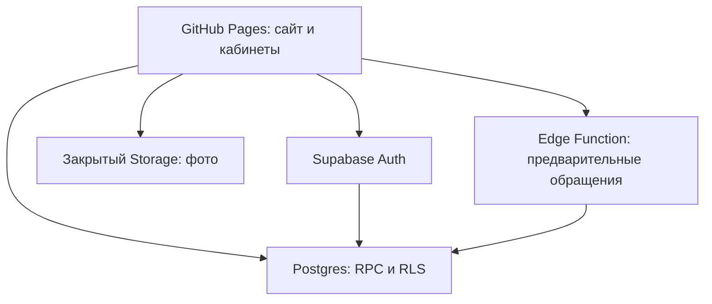

# Архитектурный аудит IRBI — 25.11.2026

Проверен репозиторий irbisvolya-wq/irbi-site на main (исходная версия 564668f), действующая база Supabase, серверные функции, RLS, разрешения, Storage и исходники трёх Edge Functions. Это инженерная проверка доступного контура, не независимый пентест и не подтверждение всех внешних интеграций.

## Вывод

Архитектура пригодна для первого небольшого запуска с ручным подтверждением заявок и ручным учётом фактически полученной оплаты. Переписывать сайт на другой фреймворк сейчас не требуется. Готовность базы не означает готовность всей услуги: ещё нужны операционные процессы, доставка уведомлений и проверки в браузере под реальными ролями.

## Состав системы



| Компонент | Реализация | Оценка |
| --- | --- | --- |
| Публикация | Статические HTML и ES-модули, GitHub Pages, irbicleaning.com | Работает; vercel.json не управляет текущим хостингом |
| Авторизация | Supabase Auth; email, регистрация, подтверждение, сброс пароля | Код есть; фактическую доставку писем нужно проверять отдельно |
| Роли | customer, cleaner, dispatcher, admin | Серверные проверки и ограничения записей есть |
| Заказ | Клиентская заявка, согласование параметров, назначение, последовательные статусы | Серверный цикл проверен с откатом |
| Календарь | Отдельная пагинированная выборка; интервалы и запрет пересечения назначений в Postgres | Базовый контроль есть; время дороги между адресами не моделируется |
| Качество | Чек-листы, инциденты, согласие на фото, частный бакет | Есть; надёжность повторных загрузок фото требует доработки |
| Переписка | Сообщения по заявке; внутренние уведомления клиента | Есть; доставка уведомлений команде за пределами открытого кабинета не подтверждена |
| Деньги | Отдельные оплаты, нарахования, материалы, прямые/постоянные расходы, финансовые представления | Есть ручной сценарий; эквайринг и возвраты не завершены |
| Подписки | Таблицы и некоторые RPC | Нет законченного сценария управления и генерации визитов в текущем сайте |
| CRM/лиды | Edge Function сохраняет предварительное обращение в prelaunch_leads | В этой функции нет отправки в HubSpot; внешний обработчик синхронизации не подтверждён |
| Приложение | Сайт содержит кабинеты | Проверка отдельного FlutterFlow-проекта, магазинов приложений и push в этот аудит не входит |

## Что исправлено и применено

Миграция: supabase/patches/2026-11-25_architecture_integrity.sql.

1. Настройка характеристик объекта теперь объединяет данные с существующими cleaning_features. Ранее она целиком заменяла JSON, стирая requested_addons и признак предварительного расчёта. Неопределённые характеристики остаются без изменений, как обещает интерфейс.
2. Историю изменения статуса записывает один триггер. Убрана повторная вставка из irbi_staff_action. Комментарий действия сохраняется через локальный контекст транзакции; предыдущий контекст восстанавливается. Старые дубли не удалялись.
3. irbi_photo_consent и irbi_register_photo явно отклоняют пользователя без профиля/роли. Закрыта неоднозначность SQL NULL в проверках авторизации. Пустое значение согласия также отклоняется.

Серверная миграция уже выполнена. Нельзя считать файл неприменённым только потому, что он появился в Git позже.

## Подтверждённые проверки

- Все 17 RPC, вызываемых текущим frontend, существуют в базе.
- Все публичные пользовательские таблицы имеют включённый RLS.
- Клиентские роли не имеют прямой записи в bookings, booking_items, payment_records и cleaner_earnings; изменение роли profiles также не разрешено.
- Финансовые и складские представления используют security_invoker=true.
- Бакет irbi-job-photos закрытый, с ограничением 10 МБ и JPG/PNG/WebP. Ссылки на просмотр создаются на 60 секунд.
- В проверенных публичных таблицах клиентским ролям не выданы TRUNCATE, REFERENCES и TRIGGER.
- SQL-проверка создаёт отдельные временные учётные записи в транзакции и завершает её ROLLBACK. Реальные роли и заказы не используются как изменяемые фикстуры.
- В SQL прошли: полный цикл, защита чужой заявки, запрет самоповышения и изменения цены клиентом, сохранение requested_addons, один элемент истории на переход, сохранение комментария, отказ при отсутствующем профиле.
- Финансовая сверка тестового заказа: получено 1200, труд 600, вклад после этих затрат 600. Это тест данных, не подтверждение доходности бизнеса.
- Локальный запуск node --test tests/*.cjs tests/*.mjs завершился успешно: 46 результатов Node test runner, 0 ошибок. Некоторые файлы дополнительно выполняют собственные серии проверок.
- Синтаксис всех корневых JS-модулей проверен. Локальные ссылки страниц и импорты модулей разрешаются.
- CI main и GitHub Pages уже работали успешно в этой сессии. SQL-проверки не входят в текущий GitHub CI: они запускаются отдельно против базы.

Новый воспроизводимый серверный тест: supabase/tests/architecture_integrity_rollback.sql.

## Задачи до приёма первых реальных заказов

| Приоритет | Задача | Что считать готовностью |
| --- | --- | --- |
| P1 | Рабочее оповещение координатора | Новая заявка и проблема приходят в выбранный канал; есть повторные попытки, журнал ошибок и контроль пропущенных событий |
| P1 | Разбор prelaunch-обращений | Уполномоченный сотрудник видит контакт, статус обработки и результат; доставка в CRM проверена целиком |
| P1 | Профиль реального клинера и проверка ролей | Назначенный сотрудник проходит рабочий путь на телефоне; чужие заказы и финансовые разделы недоступны |
| P1 | Контакты исполнителя и правила услуги | Подтверждены владельцем реквизиты/контакт, состав уборки, переносы, отмены, претензии и обработка данных; опубликованы реальные условия |
| P1 | Отмена, перенос, отказ клинера | Определены разрешённые переходы, освобождение слота, уведомление клиента и журнал причины; до автоматизации нужен проверенный ручной порядок |
| P1 | Резервное копирование и восстановление | Есть доступная резервная копия базы, схема, функции и объекты Storage; выполнена пробная процедура восстановления |
| P1 | Фактические email и тест на телефоне | Регистрация, письмо подтверждения, вход, восстановление и повторная заявка проверены в реальном браузере |
| P1 | Обрыв связи при записях | Фото, склад и расходы имеют устойчивые идентификаторы операций или явную сверку перед повтором, включая перезагрузку страницы |

Администратор существует. На момент проверки нет профиля cleaner. Автоматически менять роли реальных пользователей нельзя: сотрудник и его аккаунт должны быть явно определены.

## Следующая техническая очередь

- Собрать каталог/прайс в один версионируемый источник. Сейчас цены повторяются в app.js, booking.js, HTML и SQL; таблица services не является единым рабочим прайсом. Сервер рассчитывает заявку сам, поэтому подмена цены клиентом напрямую не принимается. До объединения нужен тест соответствия всех вариантов.
- Разделить portal.js по задачам: авторизация, координация, характеристики объекта, фото, инциденты, график. Сейчас это крупный модуль, который трудно менять и тестировать.
- Использовать один экземпляр Supabase-клиента на страницу. В portal.html его отдельно создают несколько модулей с общим хранилищем сессии.
- Убрать загрузку SDK из внешнего CDN во время работы в пользу локальной сборки с зафиксированными зависимостями. Сейчас доступность esm.sh влияет на загрузку кабинетов.
- Убрать неоднозначность между старым advance_booking_status/assign_booking_cleaner и новым сценарием согласования. Изменения заказа должны проходить через единый набор проверенных переходов.
- Довести загрузку фото до одной восстанавливаемой операции: файл может загрузиться, а запись booking_photos — не сохраниться. Нужны повторная регистрация по тому же пути и контролируемая очистка незарегистрированных объектов.
- Увести отчётные границы месяца на явно выбранный часовой пояс бизнеса. Сейчас SQL использует date_trunc от часового пояса сессии, а frontend — часовой пояс устройства.
- Добавить ограниченные очереди запросов и защиту от злоупотребления для платных внешних функций. irbi-assistant проверяет JWT внутри функции; google-places-autocomplete имеет verify_jwt=true, но в исходнике нет отдельной пользовательской квоты.
- Настроить мониторинг ошибок и здоровья рабочих сценариев. Наличие CI не обнаруживает остановившуюся доставку заявок.
- Сделать выпуск сайта зависимым от успешных проверок. Текущая стандартная публикация Pages и Application checks запускаются отдельно; зелёный CI не является обязательным шлюзом публикации.
- Добавить canonical/sitemap/robots и исключить служебные страницы из индексации; при необходимости PWA/offline определить отдельный сценарий без обещания синхронизации заказов вне сети.

## Безопасность: как трактовать замечания Supabase

Security Advisor показывает отсутствие проверки скомпрометированных паролей, расширение btree_gist в public и предупреждения о доступных authenticated SECURITY DEFINER RPC. Последнее само по себе не означает уязвимость: эти RPC специально являются серверным API и проверяют роль внутри.

У private.irbi_issue_internal_notes выключен RLS. Фактические проверки показали отсутствие SELECT у anon/authenticated, а у anon также нет USAGE схемы private. Поэтому утверждение, что эта таблица автоматически доступна любому посетителю, не подтверждается. RLS здесь остаётся дополнительным уровнем защиты, который стоит оформить с политиками после проверки внутренних потребителей. В этом аудите он автоматически не включался. Возможная основа, требующая проектирования политик:

```sql
ALTER TABLE private.irbi_issue_internal_notes ENABLE ROW LEVEL SECURITY;
```

В пяти таблицах есть RLS без клиентских политик. Для серверных staging/служебных таблиц это может быть намеренным запретом клиентского доступа, а не ошибкой. Не добавлять разрешающие политики только ради удаления предупреждения.

Performance Advisor сообщает о 17 внешних ключах без покрывающего индекса, повторных permissive-политиках и вычислениях auth.uid() на строку. Это очередь оптимизации после измерения реальных запросов. Не удалять неиспользованные индексы на основании того, что в небольшом проекте ещё не было нагрузки.

Справочные ссылки:
- https://supabase.com/docs/guides/database/postgres/row-level-security
- https://supabase.com/docs/guides/auth/password-security#password-strength-and-leaked-password-protection
- https://supabase.com/docs/guides/database/database-linter

## Сохранение серверного кода

Исходники трёх действующих Edge Functions добавлены в supabase/functions вместе с текущими verify_jwt. Это снимок существующего кода; функции не перепубликовывались и их доступ не менялся. Полная воспроизводимая схема базы и автоматизированное восстановление по-прежнему требуют отдельной работы. Набор SQL patches не является полной резервной копией.

## Граница результата

Проверен действующий код и доступная конфигурация, выполнены серверные и автоматические проверки. Не подтверждены реальная доставка писем и внешних уведомлений, восстановление из backup, полный интерфейс всех ролей на устройствах, эквайринг, возвраты, автоматические подписки и отдельный FlutterFlow-проект. Эти пункты нельзя называть готовыми на основании наличия таблиц.
